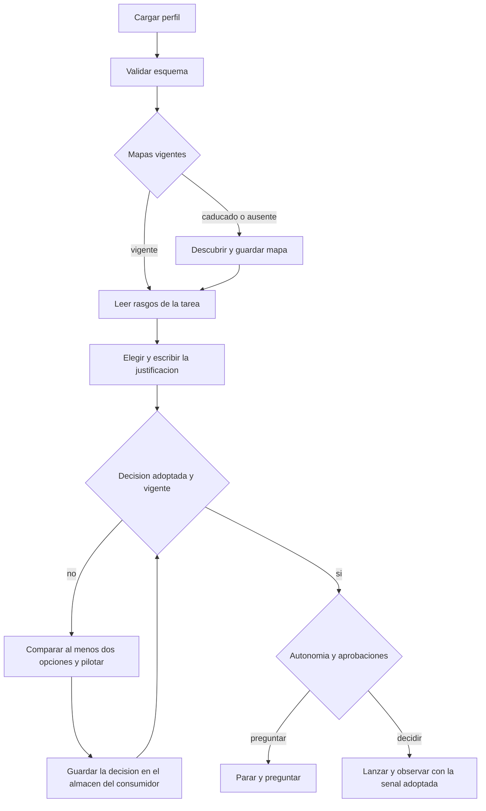

# Diseño v0.1

Fase 1: solo diseño. Este archivo es el único cambio. No hay implementación, tag ni configuración de un consumidor real.

Fecha del diseño: 2026-11-22.

Objetivo del dueño:

> Esta tarea no es para trasladar literalmente vuestras reglas actuales a un repositorio, es para desarrollar un framework o instrucciones para agentes orquestradores y dotarlos de las capacidades necesarias para que sean capaces de descubrir y razonar y definir estrategias sobre como utilizar las plataformas y los modelos disponibles, deben además ser instrucciones que permitan también forzar a los agentes a definir las mejores estrategias de integración con estas plataformas, para evitar por ejemplo, lo que paso con las escuchas de agentes en copilot. El contenido debe ser totalmente agnostico de cada plataforma y debe permitir que sea totalmente configurable de forma dinámica. Se debe definir un sistema que permita a los agentes ser lo máximo autonomos para esto, pero siempre teniendo en cuentala personalizacion de cada usuario (quizás 1 usuario solo orquestra agentes en 1 plataforma, quizás otro usuario no usa copilot ni cursor)

La cita de arriba reproduce el encargo tal cual. Las secciones 1 a 5 y 8 son la norma y no nombran plataformas ni modelos. La sección 6 es el único ejemplo aplicado y sí puede nombrarlos. La sección 7 usa plataformas ficticias.

## Ciclo de una tarea

El agente recorre esta puerta en cada tarea. Si un paso falla, no lanza.



Lista de salida. Las siete tienen que cumplirse:

1. El perfil valida contra el esquema en ese momento.
2. La plataforma elegida está habilitada en el perfil.
3. Hay un mapa de esa plataforma con `caduca_en` en el futuro y con fuentes.
4. Hay una decisión de integración `adoptada`, sin caducar, atada a ese mapa, con las siete respuestas, al menos dos opciones y un piloto que cumplió sus criterios.
5. Lanzar está en `decide_solo` y no está en `aprobaciones`.
6. El coste estimado, con los descuentos que sigan vigentes, cabe en el tope.
7. La justificación ya está escrita en el registro del consumidor.

## 1. Perfil del consumidor

El perfil es la personalización. Cambia cuando el consumidor quiere, sin publicar una versión nueva del framework. Se valida al cargar, antes de descubrir y antes de lanzar. Un perfil inválido detiene la tarea.

Un perfil con cero plataformas es válido. En ese caso el agente se detiene después de validar y dice que no hay dónde lanzar. No inventa una plataforma.

### 1.1 Campos

Esquema `perfil/v0.1`. Objeto cerrado: un campo que no esté aquí invalida el perfil. Así no cabe un valor de secreto con otro nombre.

| Campo | Tipo | Obligatorio | Regla |
| --- | --- | --- | --- |
| `esquema` | string | sí | Constante `perfil/v0.1`. |
| `id` | string | sí | Identificador del perfil. No es un secreto. |
| `actualizado_en` | date-time | sí | Momento del último cambio del perfil. |
| `plataformas` | array | sí | Puede estar vacío. |
| `plataformas[].id` | string | sí | Lo elige el consumidor. No es un enumerado del framework. |
| `plataformas[].habilitada` | boolean | sí | `false` saca la plataforma de la elección. El mapa puede seguir guardado. |
| `plataformas[].entrada` | objeto | sí | Semilla del descubrimiento. |
| `plataformas[].entrada.tipo` | enum | sí | `documentacion`, `api` o `ambas`. |
| `plataformas[].entrada.referencia` | string | sí | URL de documentación o ruta de API. Sin credenciales dentro. |
| `credenciales` | array | sí | Puede estar vacío. Solo referencias. |
| `credenciales[].id` | string | sí | Único dentro del perfil. |
| `credenciales[].plataforma_id` | string | sí | Tiene que existir en `plataformas`. |
| `credenciales[].tipo` | enum | sí | `token_usuario`, `token_aplicacion`, `clave_api`, `sesion`, `otro`. |
| `credenciales[].referencia` | string | sí | URI de un gestor de secretos. El esquema rechaza el campo `valor`. |
| `credenciales[].alcances` | array de string | sí | Lo que el agente cree que esa referencia permite. Lo confirma el descubrimiento. |
| `presupuesto` | objeto | sí | Ver tabla siguiente. |
| `preferencias` | objeto | sí | Ver tabla siguiente. |
| `aprobaciones` | array | sí | Acciones que una persona tiene que autorizar. |
| `autonomia` | objeto | sí | Qué decide el agente y qué pregunta. |

Presupuesto:

| Campo | Tipo | Obligatorio | Regla |
| --- | --- | --- | --- |
| `moneda` | string | sí | Código de moneda o `credito`. |
| `tope_por_tarea` | number | sí | Mayor o igual que 0. |
| `tope_periodo` | number | sí | Mayor o igual que 0. |
| `periodo` | enum | sí | `hora`, `dia`, `mes`. |
| `aviso_porcentaje` | number | sí | De 0 a 100. Al cruzarlo, el agente avisa y sigue si aún cabe en el tope. |
| `al_superar` | enum | sí | `preguntar` o `rechazar`. |

Si el mapa tarifica en otra unidad, el mapa trae la conversión con su fuente y su fecha. Sin conversión documentada, el agente pregunta antes de lanzar.

Preferencias:

| Campo | Tipo | Obligatorio | Regla |
| --- | --- | --- | --- |
| `prioridad` | enum | sí | `coste`, `velocidad`, `calidad`, `equilibrio`. |
| `idiomas` | array de string | sí | Puede estar vacío. |
| `notas` | string | sí | Puede ser `""`. |
| `vetos` | array de string | sí | Condiciones en texto. Una coincidencia obliga a preguntar. |
| `acepta_configuracion_por_repo` | boolean | sí | Por defecto `false`. Con `false`, una opción que no escala se rechaza sin piloto. |

Aprobación:

| Campo | Tipo | Obligatorio | Regla |
| --- | --- | --- | --- |
| `accion` | enum | sí | Ver lista de abajo. |
| `quien` | string | sí | Persona o rol. No es una credencial. |

Acciones que pueden exigir aprobación: `fusionar`, `aprobar_ejecucion`, `primer_uso_de_plataforma`, `adoptar_integracion`, `crear_canal_de_escucha`, `superar_tope`, `escribir_en_repo_ajeno`, `entregar_secreto`.

Autonomía:

| Campo | Tipo | Obligatorio | Regla |
| --- | --- | --- | --- |
| `decide_solo` | array de enum | sí | |
| `pregunta` | array de enum | sí | |

Los dos arrays usan este enumerado y no comparten elementos: `refrescar_mapa`, `elegir_plataforma`, `elegir_agente`, `fijar_parametros`, `lanzar`, `sondear`, `abrir_piloto`, `adoptar_integracion`, `recoger_resultados`, `gastar_hasta_el_tope`.

Un valor del enumerado que no esté en ninguno de los dos arrays se trata como `pregunta`. Una acción que también esté en `aprobaciones` no es autónoma, aunque aparezca en `decide_solo`.

Las credenciales no llevan el secreto. `referencia` apunta fuera, por ejemplo `almacen-secreto://perfil-una/lanzar`. El validador de la fase 2 rechaza un campo `valor` y cualquier string con forma de secreto asignado, como `clave=` seguido de un valor. La lista concreta de prefijos vive en `comprobaciones/`, que es datos del validador, no texto del núcleo.

## 2. Descubrimiento

El descubrimiento rellena un mapa de capacidades por cada plataforma habilitada. El mapa tiene fecha, fuentes y caducidad. Cuando `caduca_en` ya pasó, el agente lo vuelve a levantar antes de usar esa plataforma. No reutiliza un mapa caducado.

### 2.1 Procedimiento

Para cada plataforma con `habilitada: true`:

1. Leer la ficha del consumidor si existe. Si no existe, crearla con la semilla `entrada` del perfil. Sin `entrada`, parar y preguntar. No completar la entrada de memoria.
2. Si el mapa falta o está caducado, volver a leer la documentación y, si `entrada.tipo` es `api` o `ambas`, llamar a la API con la referencia de credencial. La llamada de lectura es `refrescar_mapa`.
3. Anotar cada agente o modelo que la fuente liste, con sus parámetros, el coste, los descuentos que sigan en vigor y los límites.
4. Anotar cómo se lanza, qué identificador devuelve el lanzamiento, cómo se observa el progreso, cómo se reconoce el final y cómo se recogen los resultados.
5. Anotar qué aprobaciones pide y qué configuración hay que dejar en el repositorio de trabajo. Para cada pieza, anotar si hace falta repetirla en cada repositorio.
6. Separar lo documentado, lo observado en un piloto y lo que se buscó y no apareció. Un hueco queda en `no_documentado` con las páginas buscadas. No se rellena.
7. Si dos fuentes oficiales discrepan, el mapa guarda las dos, con su URL y la hora de la lectura. El agente no elige una en silencio.
8. Fijar `caduca_en` en el mínimo entre el fin del descuento más cercano y el plazo por defecto. El plazo por defecto está en las decisiones abiertas. Recomendación: 7 días.

Un hecho es `documentado` cuando el mapa cita URL, apartado y el nombre del campo o de la acción. Es `observado` cuando solo apareció en una respuesta del piloto. Es `no_documentado` cuando se buscó en las fuentes citadas y no estaba.

### 2.2 Mapa de capacidades

Esquema `mapa/v0.1`. Lo escribe el agente en el almacén del consumidor. Una instantánea no se reescribe: la siguiente lectura es otro `id`.

| Campo | Tipo | Obligatorio | Regla |
| --- | --- | --- | --- |
| `esquema` | string | sí | `mapa/v0.1`. |
| `id` | string | sí | |
| `plataforma_id` | string | sí | La del perfil. |
| `generado_en` | date-time | sí | |
| `caduca_en` | date-time | sí | Posterior a `generado_en`. |
| `fuentes` | array | sí | Al menos una. |
| `fuentes[].url` | string | sí | |
| `fuentes[].consultada_en` | date-time | sí | |
| `fuentes[].que_aporta` | string | sí | |
| `agentes` | array | sí | Puede estar vacío si la fuente no lista ninguno. Eso se explica en `no_documentado`. |
| `no_documentado` | array de string | sí | Huecos buscados. |

Cada agente:

| Campo | Tipo | Obligatorio | Regla |
| --- | --- | --- | --- |
| `id` | string | sí | El de la fuente, no uno inventado. |
| `parametros` | array | sí | |
| `parametros[].id` | string | sí | |
| `parametros[].tipo` | string | sí | |
| `parametros[].obligatorio` | boolean | sí | |
| `parametros[].valores` | array de string | sí | Vacío si la fuente no fija la lista. |
| `parametros[].fuente` | string | sí | URL. |
| `coste` | objeto | sí | |
| `coste.unidad` | string | sí | Tiene que poder convertirse a `presupuesto.moneda`, o el campo `conversion` es obligatorio. |
| `coste.tarifas` | array | sí | Cada tarifa: `concepto`, `importe`, `por`, `fuente`. |
| `coste.descuentos` | array | sí | Cada uno: `descripcion`, `vence_en` (date-time o null si la fuente no pone fin), `fuente`. |
| `coste.limites` | array | sí | Cada uno: `nombre`, `valor`, `ventana`, `fuente`. |
| `coste.conversion` | objeto o null | sí | `a_moneda`, `tasa`, `fuente`, `consultada_en`. |
| `lanzamiento` | objeto | sí | `como`, `identificador_devuelto`, `documentado` (boolean), `fuente`. |
| `progreso` | objeto | sí | `como`, `estados` (array), `documentado`, `fuente`. |
| `fin` | objeto | sí | `senales` con al menos el intento de buscarlas. |
| `fin.senales[].mecanismo` | enum | sí | `evento` o `consulta`. |
| `fin.senales[].nombre` | string | sí | |
| `fin.senales[].terminal` | boolean | sí | |
| `fin.senales[].quien_recibe` | enum | sí | `orquestador`, `humano`, `ambos`, `desconocido`. |
| `fin.senales[].documentado` | boolean | sí | |
| `fin.senales[].fuente` | string | sí | |
| `resultados` | objeto | sí | `como`, `artefactos` (array de string), `fuente`. |
| `aprobaciones` | array de string | sí | |
| `configuracion_repo` | array | sí | Cada una: `que`, `obligatoria` (boolean), `escala_sin_cada_repo` (boolean), `fuente`. |

## 3. Razonamiento y estrategia por tarea

La elección cruza tres cosas: el mapa vigente, el perfil y los rasgos de la tarea. Los rasgos son cuatro niveles `bajo`, `medio` o `alto`: `razonamiento`, `contexto`, `velocidad`, `coste`. Los pone quien encarga la tarea. Si faltan, el agente pregunta.

### 3.1 Cómo elige

1. Candidatos: agentes de plataformas habilitadas, con mapa vigente.
2. Descarta los que pasan el tope por tarea con el coste estimado. El estimado usa las tarifas y solo los descuentos con `vence_en` aún en el futuro o con `vence_en` null.
3. Ordena el resto con `preferencias.prioridad`. A igualdad, `equilibrio` prefiere el que tenga la señal de fin documentada. Un candidato cuya señal de fin sea solo `no_documentado` queda detrás de uno con señal documentada.
4. Si `vetos` encaja con el candidato ganador, el agente pregunta.
5. Si no queda ningún candidato, el agente pregunta. No añade una plataforma que el perfil no tenga.
6. Escribe el registro de justificación y después lanza, si la puerta de salida lo permite.

La plataforma y el agente se eligen en cada tarea. Un perfil de una sola plataforma deja esa elección cerrada por el perfil, y la justificación lo dice.

### 3.2 Dónde queda la justificación

En el almacén del consumidor, nunca en el repositorio del framework. Un fichero por tarea:

`registro/<año>/<mes>/<tarea_id>.json`

Se escribe antes de lanzar. Si la puerta se para a preguntar, el fichero se escribe igual, con `lanzado: false`.

Esquema `registro-justificacion/v0.1`:

| Campo | Tipo | Obligatorio | Regla |
| --- | --- | --- | --- |
| `esquema` | string | sí | `registro-justificacion/v0.1`. |
| `id` | string | sí | |
| `tarea_id` | string | sí | |
| `momento` | date-time | sí | |
| `perfil_id` | string | sí | |
| `perfil_actualizado_en` | date-time | sí | La versión del perfil usada. |
| `mapas` | array de string | sí | Ids de mapas leídos. |
| `decision_id` | string o null | sí | Null si aún no hay decisión adoptada. |
| `rasgos` | objeto | sí | Los cuatro niveles. |
| `candidatos` | array | sí | Cada uno: `plataforma_id`, `agente_id`, `encaja` (boolean), `motivo`. |
| `elegido` | objeto o null | sí | `plataforma_id`, `agente_id`, `parametros` (objeto). Null si no hay elección. |
| `por_que` | string | sí | |
| `coste_estimado` | objeto | sí | `importe`, `moneda`, `descuentos_aplicados` (array de string). |
| `autonomia` | enum | sí | `decidido` o `preguntado`. |
| `lanzado` | boolean | sí | |

## 4. Estrategia de integración

Hace falta una decisión adoptada antes del primer uso de una plataforma, y otra cada vez que cambie un hecho del que esa decisión depende. Sin ella, la puerta de salida no llega al lanzamiento.

El agente no crea el canal, no arranca el piloto y no copia la estrategia a su memoria durable hasta tener escritas las respuestas de abajo. `memoria_durable_actualizada` solo puede ser true cuando el estado es `adoptada`.

Responde estas siete preguntas para cada opción. El esquema las hace obligatorias:

1. Cómo sé que terminó: evento o consulta, y si está documentado. Una señal no documentada puede entrar en un piloto como hecho observado. No pasa a contrato hasta que el piloto cumple los criterios y la decisión queda `adoptada`.
2. Quién recibe la señal: el orquestador, el humano, o los dos. Si quien tiene que enterarse es el orquestador y la respuesta es solo el humano, esa opción no cierra la tarea.
3. Qué puede autenticar el destino, y si el emisor puede enviar esa prueba. Un secreto de firma no sustituye una cabecera o un campo que el emisor no envía. Si no puede enviarlo, la opción pasa a `rechazada` antes de crear el canal y antes del piloto.
4. Si escala sin configurar cada repositorio a mano. Con `acepta_configuracion_por_repo` en false, una opción que no escala pasa a `rechazada` antes de probarla.
5. Cuánto cuesta vigilar, y si ese coste gasta el presupuesto del modelo.
6. Los modos de fallo.
7. Las aprobaciones.

Si quien aprueba veta una opción antes del piloto, queda `rechazada`, con el veto escrito, y no se ejecuta. Eso no cuenta como piloto fallido.

Tiene que comparar al menos dos opciones. Si la documentación solo ofrece una señal, la segunda opción es no usar la plataforma hasta tener otra señal. Comparar contra “no integrar todavía” cuenta.

Un canal nuevo no se crea mientras la autenticación del destino siga pendiente. Un canal que el orquestador ya tiene puede pasar a `en_piloto` con esa respuesta en `pendiente`. El piloto no se da por cumplido hasta cerrarla.

Después corre un piloto, más pequeño que la tarea real, en un repositorio que el perfil permita. Los criterios de paso se escriben antes del piloto. El resultado se guarda en la decisión. Adoptar es un paso distinto de pilotar: si `adoptar_integracion` está en `aprobaciones` o en `pregunta`, el agente deja el estado en `en_piloto` y espera.

### 4.1 Cuándo se rehace

La decisión incluye `depende_de`: una lista de rutas del mapa (por ejemplo `agentes/0/fin`). Un mapa nuevo invalida la decisión si alguna de esas rutas cambió. Si `depende_de` viene vacío, invalidan los cambios en `fin`, `lanzamiento`, `aprobaciones` y `configuracion_repo`. Un cambio solo de precio no obliga a repetir el piloto.

También se rehace si cambia la credencial usada, si el piloto pasa a `fallido`, o si `caduca_en` de la decisión llegó.

### 4.2 Decisión de integración

Esquema `decision-integracion/v0.1`. Vive en el almacén del consumidor.

| Campo | Tipo | Obligatorio | Regla |
| --- | --- | --- | --- |
| `esquema` | string | sí | `decision-integracion/v0.1`. |
| `id` | string | sí | |
| `plataforma_id` | string | sí | |
| `mapa_id` | string | sí | Mapa contra el que se decidió. |
| `depende_de` | array de string | sí | Rutas del mapa. Puede estar vacío y entonces rige la regla del apartado 4.1. |
| `disparador` | enum | sí | `primer_uso`, `cambio_mapa`, `cambio_perfil`, `fallo`, `caducidad`. |
| `opciones` | array | sí | Mínimo 2. |
| `piloto` | objeto | sí | |
| `elegida_id` | string | sí | Una de `opciones[].id`. |
| `estado` | enum | sí | `propuesta`, `en_piloto`, `adoptada`, `rechazada`. |
| `vigente_desde` | date-time o null | sí | Null hasta `adoptada`. |
| `caduca_en` | date-time | sí | |
| `como_se_que_termino` | objeto | sí | Copia de la opción elegida, para que el esquema lo exija en la raíz. |
| `quien_recibe` | enum | sí | `orquestador`, `humano`, `ambos`. |
| `autenticacion_destino` | objeto | sí | La de la opción elegida. |
| `autenticacion_destino.exige` | string | sí | Qué prueba pide el destino. `pendiente` si aún no se sabe. |
| `autenticacion_destino.emisor_puede_enviarlo` | boolean o null | sí | Null si sigue pendiente. False rechaza la opción sin piloto. |
| `autenticacion_destino.secreto_de_firma_no_equivale` | boolean | sí | True cuando un secreto de firma no cubre lo que el destino exige. |
| `autenticacion_destino.fuente` | string | sí | |
| `reutiliza_canal_existente` | boolean | sí | True solo si el orquestador ya tenía ese canal. |
| `escala_sin_cada_repo` | boolean | sí | |
| `coste_de_vigilar` | objeto | sí | `unidad`, `cantidad_estimada`, `consume_presupuesto_de_modelo` (boolean), `fuente`. |
| `modos_de_fallo` | array de string | sí | Al menos uno. |
| `aprobaciones` | array de string | sí | |
| `memoria_durable_actualizada` | boolean | sí | Solo puede ser true si `estado` es `adoptada`. |

Cada opción repite las siete respuestas: `id`, `resumen`, `como_se_que_termino` (`mecanismo`, `nombre`, `documentado`, `fuente`), `quien_recibe`, `autenticacion_destino`, `reutiliza_canal_existente`, `escala_sin_cada_repo`, `coste_de_vigilar`, `modos_de_fallo`, `aprobaciones`.

El piloto: `estado` (`pendiente`, `hecho`, `fallido`), `criterios` (array, mínimo 1), `observado` (string), `fecha` (date-time o null).

Para pasar a `adoptada`, `piloto.estado` tiene que ser `hecho`, `observado` tiene que decir que los criterios se cumplieron, `emisor_puede_enviarlo` tiene que ser true y `quien_recibe` no puede ser solo `humano` cuando quien debe enterarse es el orquestador.

## 5. Separación

El núcleo son las instrucciones que aplican a cualquier perfil: validar, descubrir, elegir, integrar y registrar. Esas instrucciones hablan de plataformas y de agentes como campos del perfil y del mapa. No contienen nombres propios de productos ni identificadores de modelos.

Las fichas las genera el agente al descubrir. Viven en el almacén del consumidor, junto al mapa, la decisión y el registro. Una ficha nueva no exige un cambio en el framework: basta con añadir una plataforma al perfil, con su `entrada`, y dejar que el ciclo corra.

Esquema `ficha/v0.1`:

| Campo | Tipo | Obligatorio | Regla |
| --- | --- | --- | --- |
| `esquema` | string | sí | `ficha/v0.1`. |
| `id` | string | sí | Igual que `plataformas[].id`. |
| `perfil_id` | string | sí | |
| `habilitada` | boolean | sí | |
| `entrada` | objeto | sí | La misma forma que en el perfil. |
| `credenciales_ids` | array de string | sí | |
| `mapa_vigente_id` | string o null | sí | |
| `decision_vigente_id` | string o null | sí | |
| `creada_en` | date-time | sí | |
| `actualizada_en` | date-time | sí | |

La ficha no copia el catálogo ni los precios. Eso está en el mapa, que caduca. La ficha solo señala el mapa vigente y la decisión vigente.

Si un texto del núcleo necesita un nombre de producto para ser verdad, ese texto no va en el núcleo. Va en el mapa, escrito en el descubrimiento, con su fuente.

Los ejemplos que no sean el caso aplicado llevan plataforma ficticia y el marcado `ficticio`.

## 6. Caso aplicado: saber cuándo termina el agente

<!-- ejemplo-aplicado:inicio -->

Esta sección es un ejemplo aplicado. Nombra una plataforma real. El resto del documento no la usa como norma. El encargo pide además un perfil que no use esta plataforma ni Cursor. Ese perfil es el tercero del apartado 7 y allí no se repiten los nombres.

El problema: una persona asigna una issue a un coding agent de GitHub Copilot y el orquestador tiene que enterarse de que el trabajo terminó. La consulta de la documentación es del 2026-11-22. Los precios y las listas de modelos no se copian: cambian, y dos páginas oficiales ya no coincidían entre sí ese día.

### 6.1 Qué está documentado

Hay dos formas de lanzar, y no devuelven lo mismo.

Asignar una issue. La documentación de uso dice que Copilot trabaja, abre una pull request y pide una revisión al terminar. El arranque por issue está en public preview. Otra página dice que asignar una issue siempre crea una pull request. El tutorial de mejora de un proyecto precisa los tiempos: a los pocos momentos aparece en la issue el enlace a una pull request en borrador; cuando Copilot termina, quita `[WIP]` del título y añade al usuario como revisor. La persona pulsa después “Ready for review”.

La página de riesgos dice que el agente no puede marcar la pull request como “Ready for review”, no puede aprobarla y no puede fusionarla. Por defecto, los workflows de GitHub Actions no se disparan hasta que el código está revisado y alguien con escritura pulsa “Approve and run workflows”. Un administrador del repositorio puede desactivar ese requisito en los ajustes de ese repositorio. Copilot es el autor de los commits y la persona que asignó la issue es coautora. Los commits van firmados y se ven como verificados. Fuera del caso de una mención en una pull request ya abierta, el agente solo puede empujar a una rama nueva `copilot/`. La aprobación de quien encargó el trabajo no cuenta para las aprobaciones obligatorias.

La API de issues acepta al asignado `copilot-swe-agent[bot]`, con `agent_assignment` (`target_repo`, `base_branch`, `custom_instructions`, `custom_agent`, `model`). Hace falta un token de usuario: PAT, OAuth o user-to-server de una GitHub App. Un PAT fine-grained necesita metadata en lectura y actions, contents, issues y pull requests en lectura y escritura. Un PAT classic necesita el ámbito `repo`. GraphQL usa `agentAssignment` y la cabecera `GraphQL-Features: coding_agent_model_selection`. El login que hay que encontrar en `suggestedActors` es `copilot-swe-agent`. La respuesta documentada de este camino es una issue. No documenta un id de tarea.

La API de tareas es el otro camino: `POST /agents/repos/{owner}/{repo}/tasks`. También está en public preview, solo con token de usuario, y el token de instalación de una GitHub App no sirve. El cuerpo exige `prompt`. `model` es opcional. `create_pull_request` existe y su valor por defecto es `false`. La respuesta incluye `id` y `state`. Consultar es `GET /agents/repos/{owner}/{repo}/tasks/{task_id}` o `GET /agents/tasks/{task_id}`. Estados de la tarea y de cada sesión: `queued`, `in_progress`, `completed`, `failed`, `idle`, `waiting_for_user`, `timed_out`, `cancelled`. La sesión trae `completed_at`, `model`, `usage` (`ai_credits` o `premium_requests`, más `amount`) y `error.message`. Los artefactos son de tipo `pull` o `branch`. Este camino sí devuelve el id que luego se consulta. La documentación no dice que una issue asignada aparezca en esa lista.

Progreso visible. Tras asignar, la issue recibe una reacción 👀 y enseguida la pull request en borrador, en el timeline de la issue. En la pull request, la interfaz muestra “Copilot started work” o “Copilot has started work”, según la página, y desde ahí se abre “View session”. Los logs de sesión se ven en el panel de agentes y muestran uso de tokens y duración. `gh agent-task view --repo OWNER/REPO NUMERO_DE_PR` enseña la sesión asociada a esa pull request; `--log` y `--follow` enseñan el log. El comando está en public preview y pide GitHub CLI 2.80.0 o posterior. La página no describe los campos de la salida. La página de gestión dice que parar la sesión termina el run de GitHub Actions. La documentación distingue sesiones en sandbox y sesiones en Actions. El how-to de asignar una issue no dice cuál de los dos entornos usa ese camino. Si una sesión que corre en GitHub Actions se queda colgada, la página de diagnóstico dice que agota el tiempo a la hora.

El entorno de Actions se destruye al terminar y el log sigue en el sitio web. El fichero `.github/workflows/copilot-setup-steps.yml` es anterior al trabajo: prepara dependencias, el job tiene que llamarse `copilot-setup-steps`, y solo aplica a sesiones en Actions, no al sandbox. Tiene que estar en la rama por defecto. No es la señal de fin.

Señal de fin que la interfaz documenta, para el camino de la issue: quitar `[WIP]` del título y añadir al usuario como revisor. Eso está en el tutorial, no en el esquema REST. La página de uso lo resume como “pedir una revisión cuando termina”. En el flujo de crear un repositorio nuevo, la misma documentación dice que al terminar te añade como revisor y eso dispara una notificación.

Notificaciones. `GET /notifications` puede devolver `reason = agent_session_finished`, descrito como “A Copilot cloud agent session finished”. El hilo trae `subject.title`, `subject.url` y `subject.type`. El sondeo usa `If-Modified-Since`; un 304 no consume límite. La cabecera `X-Poll-Interval` marca el mínimo; el ejemplo de la página muestra 60 segundos. Estos endpoints solo aceptan un PAT classic. El `reason` es del hilo y una notificación posterior lo sustituye.

Webhooks. El catálogo de eventos, revisado por sus apartados el 2026-11-22, termina en `workflow_run` y no tiene un evento de fin de sesión del agente. `pull_request` sí incluye las acciones `opened`, `ready_for_review`, `review_requested` y `edited`, y está disponible en webhook de repositorio, de organización y de GitHub App. Esas acciones son genéricas: la página del webhook no menciona al agente.

Timeline. `GET /repos/{owner}/{repo}/issues/{issue_number}/timeline` lista los eventos. El catálogo de tipos de evento de issue incluye `ready_for_review` y `review_requested`. No incluye un tipo con el nombre del agente. La frase “Copilot started work” está en la documentación de uso y no en ese catálogo.

Hooks. En el cloud agent, `sessionEnd` se dispara una vez por job. `reason` suele ser `complete`, `error` o `timeout`. La configuración que carga el cloud agent sale de `.github/hooks/*.json` del repositorio clonado. Los policy hooks no se cargan en el cloud. El disco es efímero. La salida de red solo alcanza, por defecto, a hostnames de GitHub y de Copilot; otro destino pide una regla de firewall de un administrador. La salida del hook `sessionEnd` no la procesa el agente: solo sirve el efecto que el propio hook haga.

Modelo y coste, sin copiar tablas. En los puntos de entrada con selector se elige modelo y, si el modelo lo permite, un nivel de razonamiento. Donde no hay selector se usa Auto. La página “Changing the AI model” y el campo `model` de la API de tareas son las dos listas oficiales, y el 2026-11-22 no decían lo mismo. La facturación vigente en las páginas de precios es por tokens, convertidos a créditos de IA: 1 crédito = 0,01 USD. Hay un descuento del 10 % con selección automática en planes de pago, en el chat y en el cloud agent. Hay un descuento del 30 % de Copilot Fusion hasta el 30 de noviembre de 2026. El objeto `usage` de la sesión todavía admite `premium_requests` además de `ai_credits`. El mapa de un consumidor tiene que guardar la página leída, la hora y la fecha de fin del descuento. La cabecera de versión de API también discrepa: el how-to de la API enseña `X-GitHub-Api-Version: 2022-11-28` y la página REST enseña `2026-03-10`.

### 6.2 Qué no está documentado

Queda en el mapa como `no_documentado`, con las páginas de la tabla de fuentes:

- Un evento de webhook cuyo nombre sea el fin de la sesión.
- Un tipo de evento de timeline con el nombre del agente, tanto de inicio como de fin.
- El id de tarea en la respuesta de asignar una issue, y si `GET /agents/repos/{owner}/{repo}/tasks` lista esa issue.
- La página de notificaciones no dice que `agent_session_finished` llegue a un bot. Las notas del apartado 6.4 dicen que le llega al humano y no a los bots.
- El nombre `copilot_work_finished`. No está en el catálogo de tipos de evento de issue ni en el de webhooks leídos el 2026-11-22. Las notas del apartado 6.4 lo observan.
- El nombre de job `Running Copilot cloud agent`. No aparece en las páginas de la tabla de fuentes. Las notas del apartado 6.4 lo usan.
- El nombre del workflow de Actions cuyo `workflow_run` completado sea el fin. Está documentado que parar la sesión acaba el run, y que el run de preparación es otro fichero.
- Los campos de salida de `gh agent-task view`. El esquema REST de la sesión sí tiene `state` y `completed_at`, pero el empalme desde el número de pull request hasta el `task_id` no está en la página de la API.
- Que `[WIP]` sea un contrato estable. Aparece en el tutorial.
- Qué entorno usa el camino de asignar una issue: sandbox o Actions. El timeout de una hora y el fichero de preparación están descritos para Actions.

### 6.3 Las siete preguntas, sobre lo que dice la documentación

Opción A. Hook `sessionEnd` dentro del repositorio.

| Pregunta | Respuesta |
| --- | --- |
| Cómo sé que terminó | Evento, documentado. Una vez por job, con `reason`. |
| Quién recibe la señal | Quien el hook llame. Si el destino no está en la red permitida, nadie. |
| ¿Escala sin tocar cada repo? | No. Hace falta `.github/hooks` en el repositorio que el agente clona. |
| Coste de vigilar | Sin créditos de IA añadidos en la documentación. El coste de operación es una regla de firewall y un endpoint. `consume_presupuesto_de_modelo: false`. |
| Fallos | Silencio si falta el fichero, si el firewall corta la salida o si el job no es el del cloud agent. El disco no conserva el aviso. |
| Aprobaciones | Escribir en el repositorio y, para salir de la red de GitHub, un administrador. |
| Autenticación del destino | El hook es código del job y puede enviar la cabecera que el destino pida. Si el destino está fuera de la red permitida, el emisor no llega. |

Opción B. Webhook de organización, o de GitHub App, sobre `pull_request` / `review_requested`, limitado a la pull request que el timeline de la issue enlazó. Se mira también `edited` por si el título pierde `[WIP]`.

| Pregunta | Respuesta |
| --- | --- |
| Cómo sé que terminó | Evento genérico documentado. El tutorial dice que, al terminar, el agente te añade como revisor. La página del webhook no dice que el emisor sea el agente. El piloto tiene que ver el emisor y la hora. |
| Quién recibe la señal | El endpoint del orquestador. La persona también recibe la notificación normal de revisión. `ambos`. |
| ¿Escala sin tocar cada repo? | Sí en una organización, con un solo webhook. La página lista disponibilidad `organization` y `app`. Un webhook `repository` no escala. |
| Coste de vigilar | Sin créditos de IA. Cuesta hospedar el endpoint y el permiso para crear el webhook. |
| Fallos | Una petición de revisión hecha por una persona produce el mismo evento. Una sesión posterior, por un comentario `@copilot`, puede repetirlo. `ready_for_review` no sirve: el agente no puede emitirlo y lo pulsa la persona. `opened` tampoco: la pull request en borrador aparece al empezar. |
| Aprobaciones | Crear el webhook de organización o instalar la aplicación. |
| Autenticación del destino | La entrega firma el cuerpo con el secret y envía `X-Hub-Signature-256`. Las cabeceras documentadas de esa entrega no incluyen una `Authorization` puesta por quien configura el webhook. Si el destino exige esa cabecera, el emisor no puede enviarla y la opción se rechaza antes de probarla. |

Opción C. Sondeo de `GET /notifications` buscando `agent_session_finished`, y como apoyo `gh agent-task view` con el número de la pull request cuando el timeline ya la enlazó.

| Pregunta | Respuesta |
| --- | --- |
| Cómo sé que terminó | Consulta. El `reason` está documentado. No es un webhook. |
| Quién recibe la señal | La página devuelve las notificaciones del usuario autenticado. No dice que un bot las reciba. Las notas del apartado 6.4 dicen que le llega al humano y no a los bots. |
| ¿Escala sin tocar cada repo? | Sí. No hay fichero en el repositorio de trabajo. |
| Coste de vigilar | Sin créditos de IA documentados. El ritmo lo marca `X-Poll-Interval`. Un 304 no gasta límite. Hace falta un PAT classic, no un fine-grained ni un token de instalación. |
| Fallos | El `reason` del hilo se sustituye: si el sondeo llega tarde, puede ver `review_requested` y haber perdido `agent_session_finished`. Hay que guardar la primera observación. El CLI no documenta el campo que indica el fin. |
| Aprobaciones | La persona crea el PAT classic y deja solo la referencia. |
| Autenticación del destino | La consulta la autentica el token de ese usuario. No es una entrega entrante. La página no dice que la notificación llegue a un bot. |

La opción de consultar `state` hasta `completed`, `failed`, `timed_out` o `cancelled` es la señal clara del camino `POST /agents/.../tasks`, porque ese camino devuelve el id. No es la señal del camino de la issue mientras el empalme no esté documentado. La página lista también `idle` y `waiting_for_user` y no dice que esos dos cierren la tarea. El piloto no los trata como fin.

Estas tres opciones salen de la documentación. La decisión está en el apartado 6.5, con las notas del apartado 6.4. Para los repos de esas notas, `review_requested` no se usa como fin: allí Copilot no lo emite al terminar.

El hook `sessionEnd` sigue descartado como vía por defecto: es el evento de fin más directo que la documentación nombra, y exige un fichero en cada repositorio y, para avisar fuera, una excepción de firewall. Con `acepta_configuracion_por_repo` en false se rechaza antes de probarlo.

### 6.4 Incidente original

Ejemplo real. Notas del equipo de los días 21 y 22 de noviembre de 2026. Lo que no está en esas notas queda pendiente. No se completa por documentación ni por cálculo.

El problema era que no había una forma estándar de que los orquestadores, los bots de Grok Bot, supieran cuándo terminaba una tarea del agente en la nube de GitHub Copilot. Los ingenieros esperaban sin señal. El dueño lo detectó y pidió acordar una estrategia. Dijo, literal:

> no implementéis una rutina periodica y aún no configureis nada en vuestras memorias sobre esto. Busquemos la opción, estandar y común [...] teniendo en cuenta que realmente, no son los agentes en cloud que trabajan esto, si no [...] algo especifico de los grok bots

Lo que se encontró:

1. La notificación oficial de fin, `agent_session_finished`, le llega al humano y no a los bots.
2. En esos repos Copilot no emite `review_requested` al terminar.
3. Hay un evento de timeline no documentado, `copilot_work_finished`, que llega unos 4 s después de que acabe el job `Running Copilot cloud agent`. En la PR #20 del portfolio, Copilot terminó a las 23:53:01 y la PR quedó `ready_for_review` a las 00:06:55, cuando la movió una persona.
4. La API de agent tasks, en preview, distingue `completed` y `failed`, pero solo consultándola.
5. Los workflows de las ramas de Copilot necesitan que un humano pulse "Approve and run".

Opciones y resultado:

| Opción | Qué se hizo | Resultado |
| --- | --- | --- |
| a) Rutina periódica de consulta | El dueño la descartó antes de probarla. | No se probó. |
| b) Webhook del repo hacia el trigger webhook de una rutina de Grok Bot | Se intentó. | Falló. El trigger exige una cabecera `Authorization` y el webhook de GitHub no puede enviarla, porque solo firma con el secret. La clave se puso por error en el campo "Secret". También se descartó por no ser mantenible: habría que configurarlo en cada repo. La rutina se borró. |
| c) Una rutina por PR con el listener de GitHub de Grok Bot | Se adoptó como piloto. Filtrada por PR. Eventos: `review-requested`, `pr-pushed`, `ci-passed`, `ci-failed`, `pr-merged` y `pr-closed`. Se borra sola al mergear o cerrar la PR. | El piloto está pendiente de la próxima tarea de Copilot. Todavía no hay resultado. No está validado. |

Sigue pendiente, porque las notas no lo dicen: por qué en esos repos no se emite `review_requested`; el cuerpo de `copilot_work_finished` y si el timeline es el de la issue o el de la pull request; la zona horaria de esas dos horas; la URL del portfolio y de la PR #20; si el listener del piloto recibe `copilot_work_finished`; cómo se autentica ese listener; si la rutina por PR hay que configurarla en cada repo; el resultado del piloto.

### 6.5 Decisión que el diseño habría tomado

El apartado 4, aplicado a estas tres opciones antes de implementar nada, descarta b) sin intentarla y deja c) en piloto, sin validar y sin copiarla a la memoria de los bots.

La a) queda `rechazada` por el veto del dueño, anterior a cualquier prueba. El veto es la frase de arriba. No es un piloto fallido. La API de tareas sigue en el mapa como consulta documentada que distingue `completed` y `failed`. No se implementa una rutina periódica. La página REST lista además otros estados; las notas solo nombran esos dos.

La b) no llega a crearse. Dos respuestas del apartado 4 salen negativas:

- Autenticación. El destino exige `Authorization`. La página de validación dice que el secret firma el cuerpo y que la firma viaja en `X-Hub-Signature-256`. La página de eventos lista las cabeceras de la entrega y no incluye `Authorization`. Las notas dicen que el webhook no puede enviar esa cabecera y que la clave se puso por error en "Secret". `emisor_puede_enviarlo` es false y `secreto_de_firma_no_equivale` es true. Se rechaza antes de crear el canal.
- Escala. Las notas dicen que habría que configurarlo en cada repo. Con `acepta_configuracion_por_repo` en false, se rechaza antes de probarla.

La rutina que en los hechos se creó y luego se borró, el diseño no la habría creado. Tampoco habría escrito la clave en "Secret".

La c) es la que queda para pilotar. Reutiliza el listener de GitHub de Grok Bot, que el orquestador ya tiene: una rutina por PR, filtrada por esa PR, con los seis eventos de las notas, y se borra al mergear o cerrar. No añade un webhook en cada repo y no pide una `Authorization` que el webhook de GitHub no envía. `reutiliza_canal_existente` es true. Las notas no dicen cómo se autentica ese listener: queda `pendiente`, y por eso puede entrar en `en_piloto` sin ser un canal nuevo. No se copia a la memoria durable. No se marca `adoptada`: las notas dicen que no hay resultado.

El piloto, para la próxima tarea de Copilot, tiene estos criterios escritos antes de esa tarea:

1. No dar por terminado en `review-requested`. En esos repos Copilot no emite `review_requested` al terminar. El tutorial dice que, al terminar, añade al usuario como revisor. Las dos cosas quedan en el mapa. Para este consumidor manda la observación.
2. No dar por terminado en `ci-passed` ni en `ci-failed`. Las notas y la página de riesgos dicen que los workflows esperan a que una persona pulse "Approve and run".
3. No dar por terminado al pasar a `ready_for_review`, ni en `pr-merged`, ni en `pr-closed`. En la PR #20 del portfolio el fin fue a las 23:53:01 y `ready_for_review` fue a las 00:06:55, movida por una persona. Borrar la rutina al mergear o cerrar es la limpieza, no la señal de fin.
4. Anotar la hora de cada evento del listener junto a la hora de fin. El piloto pasa solo si alguno coincide con el fin, no con un gesto posterior de una persona.
5. Anotar si aparece `copilot_work_finished`. Las notas lo observan, sin documentar, unos 4 s después de que acabe el job `Running Copilot cloud agent`. Los catálogos oficiales leídos el 2026-11-22 no lo nombran, y esas páginas tampoco nombran ese job. Si el listener no lo recibe, se anota. No se inventa un puente.
6. No usar `agent_session_finished` para que el bot cierre la tarea. Las notas dicen que le llega al humano y no a los bots. La página de notificaciones solo describe el buzón del usuario autenticado.

Si ninguno de los seis eventos del listener coincide con el fin, el piloto falla y la decisión no pasa a `adoptada`. `depende_de` apunta a `fin`, a `lanzamiento` y a `configuracion_repo`. `caduca_en` es corto: las APIs usadas están en public preview.

La recogida de resultados, una vez dada una señal que cumpla el criterio 4, es la pull request enlazada, los commits (cada mensaje enlaza el log de sesión) y el log que sigue publicado después de destruir el entorno. Si en esa tarea aparece un id de la API de tareas, también `artifacts` y `usage`. Las notas no dicen que ese id aparezca al asignar una issue.

### 6.6 Fuentes

Consultadas el 2026-11-22.

| Qué aporta | URL |
| --- | --- |
| Asignar una issue, pedir revisión al terminar, preview | https://docs.github.com/en/copilot/how-tos/use-copilot-agents/cloud-agent/use-cloud-agent-on-github |
| Asignar siempre crea una pull request | https://docs.github.com/en/copilot/how-tos/copilot-on-github/use-copilot-agents/kick-off-a-task |
| Borrador al poco de asignar; al terminar quita `[WIP]` y añade revisor; “Ready for review” lo pulsa la persona | https://docs.github.com/en/copilot/tutorials/cloud-agent/improve-a-project |
| El agente no marca ready, no aprueba y no fusiona; workflows parados; autoría de los commits; rama `copilot/` | https://docs.github.com/en/copilot/concepts/security-governance-and-network-settings/risks-and-mitigations |
| Revisión, aprobación que no cuenta, “Approve and run workflows” | https://docs.github.com/en/copilot/how-tos/use-copilot-agents/coding-agent/review-copilot-prs |
| 👀, borrador, “Copilot started work”, timeout de una hora | https://docs.github.com/en/copilot/how-tos/use-copilot-agents/cloud-agent/troubleshoot-cloud-agent |
| API de tareas y API de issues | https://docs.github.com/en/copilot/how-tos/use-copilot-agents/cloud-agent/use-cloud-agent-via-the-api |
| Esquema REST de tareas y sesiones | https://docs.github.com/en/rest/agent-tasks/agent-tasks?apiVersion=2026-03-10 |
| `agent_session_finished`, sondeo, PAT classic | https://docs.github.com/en/rest/activity/notifications?apiVersion=2026-03-10 |
| Catálogo de webhooks, acciones de `pull_request` | https://docs.github.com/en/webhooks/webhook-events-and-payloads |
| Tipos de evento de issue y de timeline | https://docs.github.com/en/rest/using-the-rest-api/issue-event-types |
| Timeline de la issue | https://docs.github.com/en/rest/issues/timeline?apiVersion=2026-03-10 |
| `sessionEnd`, firewall, disco efímero, hooks del repo | https://docs.github.com/en/copilot/reference/hooks-reference |
| Logs, uso, parar la sesión acaba el run de Actions | https://docs.github.com/en/copilot/how-tos/copilot-on-github/use-copilot-agents/manage-and-track-agents |
| Sesión por número de pull request | https://docs.github.com/en/copilot/how-tos/use-copilot-agents/cloud-agent/use-cloud-agent-from-cli |
| El log sobrevive al entorno de Actions | https://docs.github.com/en/copilot/concepts/security-governance-and-network-settings/session-data |
| Ajuste por repositorio para dejar correr los workflows | https://docs.github.com/en/copilot/how-tos/use-copilot-agents/cloud-agent/configuring-agent-settings |
| `copilot-setup-steps.yml` | https://docs.github.com/en/copilot/how-tos/copilot-on-github/customize-copilot/customize-cloud-agent/customize-the-agent-environment |
| Selector de modelo y de razonamiento | https://docs.github.com/en/copilot/how-tos/use-copilot-agents/cloud-agent/changing-the-ai-model |
| Tarifas por token | https://docs.github.com/en/copilot/reference/copilot-billing/models-and-pricing |
| Crédito = 0,01 USD; descuento de Fusion hasta el 2026-11-30 | https://docs.github.com/en/copilot/concepts/billing-and-usage/individuals/billing |
| 10 % con selección automática | https://docs.github.com/en/copilot/concepts/models/auto-model-selection |
| El secret firma la entrega; cabecera `X-Hub-Signature-256` | https://docs.github.com/en/webhooks/using-webhooks/validating-webhook-deliveries |
| Cabeceras de la entrega; el campo Secret al crear el webhook | https://docs.github.com/en/webhooks/using-webhooks/creating-webhooks |

```text
nombres-solo-en-este-caso:
Copilot
copilot-swe-agent
copilot/
GitHub
Cursor
Grok
```

<!-- ejemplo-aplicado:fin -->

## 7. Tres perfiles de prueba

Los tres son ficticios. La tarea de ejemplo es la misma: “añadir un test de regresión pequeño”, con rasgos `razonamiento: bajo`, `contexto: bajo`, `velocidad: medio`, `coste: bajo`. Ninguno es la configuración de un consumidor real.

En los tres, `adoptar_integracion` está en `aprobaciones` y en `pregunta`, y `acepta_configuracion_por_repo` es false. El agente puede abrir el piloto y no puede dar la integración por adoptada. No copia la estrategia a su memoria durable.

### 7.1 Una sola plataforma

`perfil-una` solo habilita `plataforma-ficticia-a`. Presupuesto: 2 USD por tarea y 40 USD al mes, `al_superar: preguntar`. Prioridad `equilibrio`.

1. Valida el perfil. Hay una plataforma y una referencia de credencial. Pasa.
2. El mapa de `plataforma-ficticia-a` está caducado. `refrescar_mapa` está en `decide_solo`. Descubre solo esa plataforma y guarda una instantánea nueva.
3. No hay segunda plataforma que comparar. El mapa ficticio vigente lista un agente capaz de editar tests, con la señal de fin documentada por consulta, y un coste estimado de 0,40 USD. Cabe en el tope.
4. Escribe el registro con `elegido.plataforma_id = plataforma-ficticia-a` y `por_que` igual a “el perfil solo habilita esta plataforma; el coste cabe”.
5. No hay decisión `adoptada`. Arma dos opciones ficticias del mapa: sondear un estado que la fuente documenta, o instalar un fichero de evento en cada repositorio. Antes del piloto responde también quién recibe la señal y si el emisor puede autenticarse en el destino. La segunda opción queda `rechazada` sin piloto: no escala, y el perfil no acepta configuración por repositorio. Si además el destino pide una credencial que esa entrega no sabe enviar, ese es otro motivo para no probarla. Abre el piloto solo de la primera, en una tarea más pequeña.
6. Guarda la decisión en `en_piloto` y pregunta, porque adoptar está en `aprobaciones`. `lanzado` queda en `false`.
7. Cuando la persona adopta, la puerta se cumple y lanza. Observa con la señal de la opción elegida.

### 7.2 Dos plataformas

`perfil-dos` habilita `plataforma-ficticia-a` y `plataforma-ficticia-b`. Prioridad `coste`. El mapa ficticio dice: A estima 0,40 USD y tarda menos; B estima 0,15 USD y tarda más. Las dos tienen señal de fin documentada.

1. Valida el perfil.
2. Refresca solo los mapas caducados. Si los dos valen, no llama.
3. Compara. Los dos caben. La prioridad `coste` elige B.
4. El registro lista los dos candidatos, con `encaja: true`, y `elegido` en B. `por_que` cita el importe y la prioridad.
5. La decisión adoptada se exige solo para B, que es la que se va a usar. A puede seguir sin decisión.
6. Si B no tiene decisión adoptada, el cuestionario es de B. Una opción que no escala, o cuyo emisor no puede autenticarse en el destino, queda `rechazada` sin piloto. El piloto es solo de la opción que pasa esas respuestas. Si ese piloto falla, el agente vuelve al paso 3 con B descartada y repite la integración para A antes de usarla.
7. Pregunta para adoptar. No lanza la tarea real hasta la adopción.

### 7.3 Ninguna plataforma del caso aplicado

`perfil-otra` habilita una sola plataforma, `plataforma-ficticia-c`. Su lista es distinta de todas las plataformas nombradas entre los marcadores del caso aplicado. Prioridad `calidad`. Un veto del perfil dice: “pregunta si la señal de fin no está documentada”.

1. Valida el perfil. La plataforma desconocida para el framework es válida porque el `id` no es un enumerado cerrado.
2. Crea la ficha con la `entrada` del perfil y descubre desde esa URL. No busca en las fuentes del caso aplicado.
3. El mapa vuelve con `fin.senales` vacío y una línea en `no_documentado`: la página de entrada no describe el final.
4. El orden del apartado 3.1 deja a este candidato por detrás de cualquiera con señal documentada. No hay otro candidato.
5. El veto encaja. El agente pregunta.
6. Si la persona sigue, las dos opciones de integración son: no usar la plataforma hasta que una fuente documente el fin, o sondear un campo que el piloto observe y marcarlo `observado`, no `documentado`.
7. El piloto, si se autoriza, es de esta plataforma. El registro no nombra las plataformas del caso aplicado. `lanzado` sigue en `false` hasta que haya una decisión `adoptada` y el veto quede respondido.

## 8. Estructura propuesta del repo

La fase 2 crea este árbol. Esta fase solo deja este archivo.

```text
docs/diseno.md
nucleo/
  ciclo.md
  perfil.md
  descubrimiento.md
  estrategia.md
  integracion.md
esquemas/
  perfil.schema.json
  mapa.schema.json
  ficha.schema.json
  decision-integracion.schema.json
  registro-justificacion.schema.json
ejemplos/
  perfiles/una.json
  perfiles/dos.json
  perfiles/otra.json
  mapas/plataforma-ficticia-a.json
  mapas/plataforma-ficticia-b.json
  mapas/plataforma-ficticia-c.json
comprobaciones/
  validar.py
  test_validar.py
```

`nucleo/` repite la norma de las secciones 1 a 5, en instrucciones que un agente pueda seguir. `ejemplos/` son los tres perfiles ficticios y tres mapas ficticios suficientes para validar. El caso aplicado no se copia a `ejemplos/`.

### 8.1 CI

Un job de validación del propio repositorio, en la fase 2. El producto de CI no forma parte del núcleo. El job hace esto:

1. Comprueba que cada fichero de `esquemas/` es JSON Schema, draft 2020-12, y que cubre los campos de este diseño.
2. Valida `ejemplos/perfiles/*.json` contra `perfil.schema.json` y `ejemplos/mapas/*.json` contra `mapa.schema.json`.
3. Valida una decisión de ejemplo con dos opciones y rechaza una fixture con una sola opción.
4. Rechaza un perfil con el campo `valor` o con un texto de secreto en claro.
5. Lee el bloque `nombres-solo-en-este-caso` de la sección 6 y falla si alguna de esas líneas aparece en `nucleo/` o en `esquemas/`. El bloque tiene que tener al menos una línea.
6. Comprueba que los tres `id` de `ejemplos/perfiles/` son `plataforma-ficticia-a`, `plataforma-ficticia-b` y `plataforma-ficticia-c` en el reparto de los apartados 7.1, 7.2 y 7.3.

`comprobaciones/test_validar.py` construye fixtures rotas (secreto, una sola opción de integración, nombre del bloque dentro de `nucleo/`) y espera salida distinta de cero. El árbol bueno sale cero.

### 8.2 Dónde vive la configuración de un consumidor

Fuera de este repositorio, en un almacén que el consumidor versione. Ejemplo de layout, sin datos reales:

```text
almacen/
  perfil.json
  fichas/<plataforma_id>.json
  mapas/<plataforma_id>/<mapa_id>.json
  decisiones/<plataforma_id>.json
  registro/<año>/<mes>/<tarea_id>.json
```

Los valores de las credenciales no están en ese árbol. `credenciales[].referencia` apunta a un gestor de secretos. El almacén recomendado es un repositorio git del consumidor, para poder revisar la decisión y la justificación. El gestor de secretos queda fuera de ese git.

El framework se referencia por una revisión fija. El consumidor no copia `nucleo/` a su almacén.

## Decisiones abiertas

| Decisión | Opciones | Recomendación |
| --- | --- | --- |
| Caducidad por defecto del mapa | 24 horas; 7 días; el mínimo entre el fin del descuento más cercano y 7 días | La tercera. Un descuento con fecha fuerza la relectura. Sin descuento con fecha, 7 días. |
| Qué cambio del mapa invalida la integración | Cualquier campo; solo las rutas listadas en `depende_de` | `depende_de`. Si viene vacío, invalidan `fin`, `lanzamiento`, `aprobaciones` y `configuracion_repo`. Un cambio de precio no repite el piloto. |
| Quién adopta tras un piloto que pasó | Siempre una persona; el perfil puede poner `adoptar_integracion` en `decide_solo` | Lo decide el perfil. Los tres perfiles de prueba lo dejan en aprobación humana. |
| Almacén del consumidor | Git; almacén de clave-valor | Git para perfil, fichas, mapas, decisiones y registro. Los secretos, en un gestor, solo referenciados. |
| Forma del registro | Un JSON por tarea; un JSONL append-only | Un JSON por tarea, en `registro/<año>/<mes>/`. Se revisa en el diff. |
| Enumerado de autonomía | Cerrado, como aquí; texto libre | Cerrado. Lo que no esté en `decide_solo` ni en `pregunta` se pregunta. |
| Consumidor sin organización | Exigir un webhook que cubra todos los repos; aceptar una consulta periódica; quedarse en el canal que el orquestador ya tiene | La consulta solo entra si quien aprueba no la ha vetado, si la recibe el orquestador y no solo el humano, y si el emisor puede autenticarse. Si no, el piloto sigue en el canal ya existente y no se adopta. No se inventa un alcance de instalación. |

## Fase 2

Cada paso se da por hecho solo si su comprobación sale bien. No se crea un tag.

1. Añadir los cinco esquemas y los tres perfiles de `ejemplos/`, más tres mapas ficticios. Comprobación: el validador acepta esos ficheros y rechaza un perfil con `valor`.
2. Añadir `nucleo/` con el ciclo, el perfil, el descubrimiento, la estrategia y la integración, sin nombres del bloque de la sección 6. Comprobación: el job del apartado 8.1 falla si se pega una línea del bloque dentro de `nucleo/`.
3. Implementar la puerta de salida sobre fixtures, sin red. Comprobación: una tarea del perfil de una plataforma, con decisión ausente, escribe un registro `lanzado: false` y una decisión `en_piloto` con dos opciones y las siete respuestas. Una opción con `emisor_puede_enviarlo` en false queda `rechazada` y no crea canal. `memoria_durable_actualizada` en true con estado distinto de `adoptada` hace fallar el validador.
4. La misma puerta con el perfil de dos plataformas. Comprobación: el registro elige la de menor coste estimado y no exige decisión adoptada para la plataforma no elegida.
5. La misma puerta con el perfil de la sección 7.3, cuyo mapa marca el fin como `no_documentado`. Comprobación: `autonomia` queda en `preguntado` y el registro no contiene líneas del bloque de la sección 6.
6. Codificar la decisión de la sección 6.5 como fixture esperado del cuestionario, con estado `en_piloto` y los criterios de piloto. Comprobación: el validador acepta esa fixture, rechaza una variante que adopte una entrega cuyo emisor no puede enviar la credencial que el destino exige, y rechaza una variante que use como fin el evento de pasar a revisión lista. Esta fixture puede vivir junto al caso aplicado y el job la excluye del barrido de nombres del núcleo.
7. Dejar el job de validación en verde en la pull request de esa fase. Parar ahí. El piloto real de una issue espera credencial y aprobación del consumidor, y no forma parte del cierre de la fase 2.
